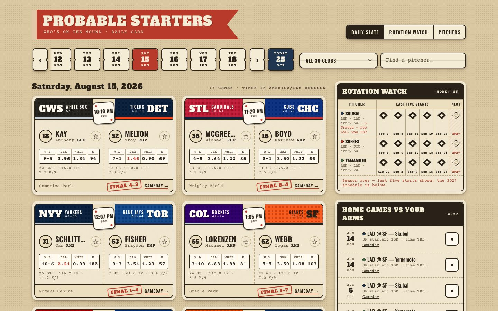
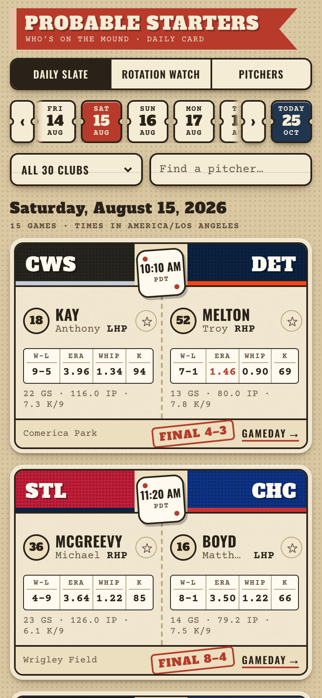
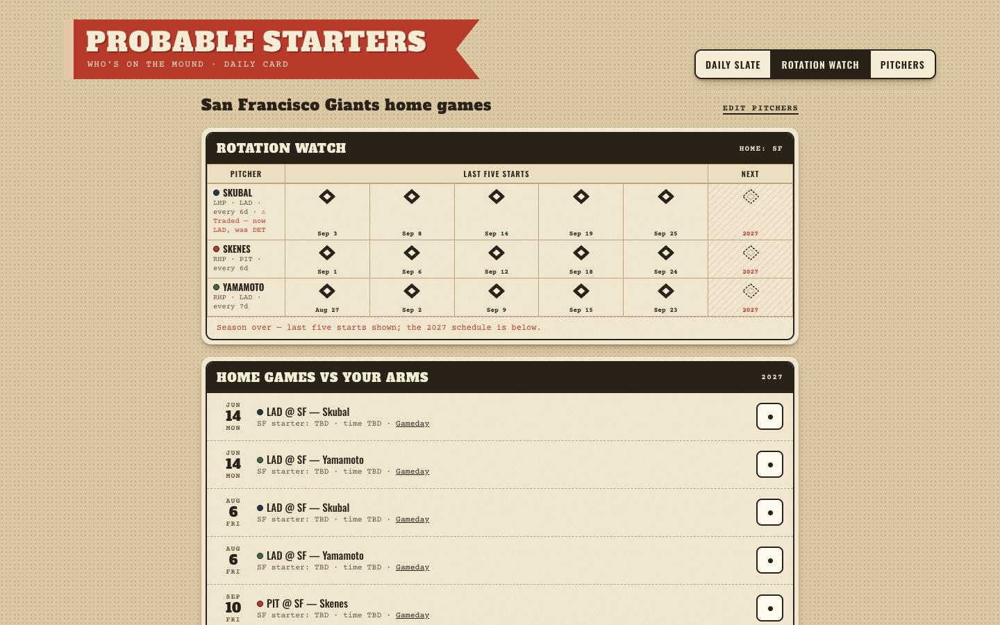
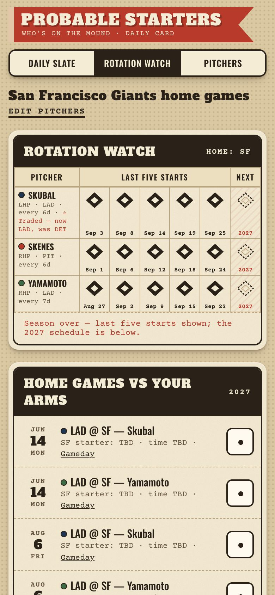
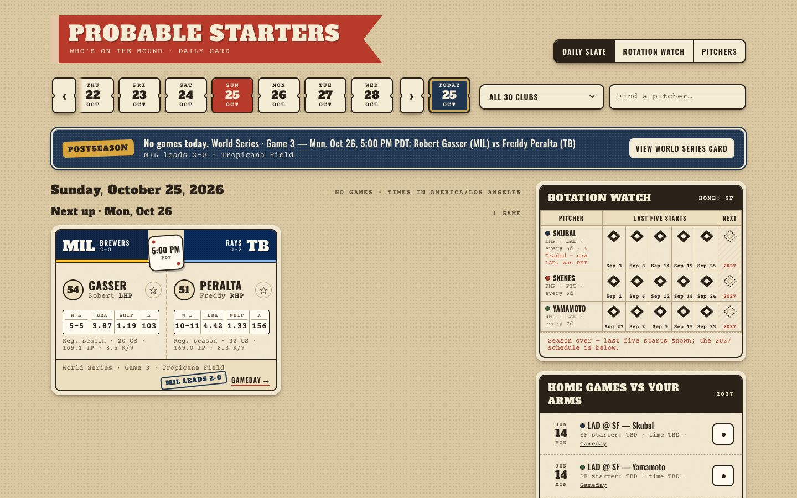
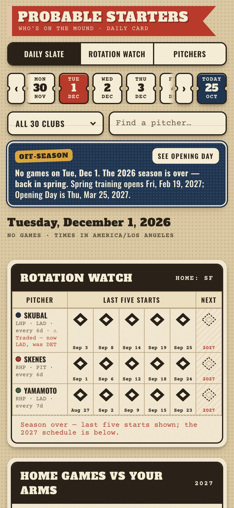

# Probable Starters

Who's on the mound today? Every MLB game's probable starters with the season line each one brings to the game, drawn as vintage baseball cards — plus a **rotation watch** that finds the home games your favourite opposing pitchers are likely to start.

**Live:** [mlb-probable-starters.vercel.app](https://mlb-probable-starters.vercel.app)

| Daily slate (desktop) | Daily slate (phone) |
| --- | --- |
|  |  |

| Rotation watch (desktop) | Rotation watch (phone) |
| --- | --- |
|  |  |

| A postseason travel day | The off-season |
| --- | --- |
|  |  |

## What it does

**Daily slate** (the main view)

- Every game on the chosen date, regular season and postseason (wild card, division series, LCS, World Series).
- Both probable starters on each card: name, throwing hand, jersey number, and their season line *entering that date* — W-L, ERA, WHIP, strikeouts, games started, innings and K/9. Postseason cards show the regular-season line and carry the series label and standing ("World Series · Game 3", "MIL leads 2-0").
- First pitch in **your** time zone, venue, doubleheader game number, and the status as a rubber stamp: FINAL with the score, LIVE, POSTPONED, SUSPENDED.
- A ticket-stub date strip (week jumps and **Today**), a club filter, and a starter search.
- Days without games say why — an off day, a postseason travel day, or the off-season — and point to the next game (with a preview of its cards) or to spring training and Opening Day.
- Tap ☆ on any starter to add them to your rotation watch.

**Rotation watch** — the original tracker

- Pick your home ballpark and the opposing starters you want to see (on the **Pitchers** tab, or with ☆ on the slate).
- A scorecard shows each pitcher's last five starts, their usual rest and the next start: confirmed by MLB, or projected onto their team's remaining schedule.
- **Home games vs your arms** lists the upcoming games at your park each pitcher may start, one per series, with dice-pip confidence:
  - three pips — **Confirmed**: MLB has announced him.
  - two pips — **Projected**: his rotation lands within a day of this game.
  - one pip — **Possible**: his team is in town, but the rotation doesn't line up (or there's too little data, e.g. next season).
- Games already played, postponed or suspended are skipped. Traded pitchers follow their new club (and the change is remembered); "may be on the IL" warnings appear only while the regular season is under way. Once your club's season is over it shows next season's schedule.

The date, tab and club live in the URL (`?date=2026-08-15`, `?tab=rotation`, `&team=SF`) so links work; your home club and pitchers are remembered in your browser's localStorage.

## Data source

Everything comes from the public [MLB Stats API](https://statsapi.mlb.com) — no key, no account. The browser calls it directly: `statsapi.mlb.com` answers plain GET requests with `Access-Control-Allow-Origin: *`, and the app sends no custom headers, so there's no CORS preflight and no server of our own. Responses are cached in memory for the session (two minutes, keyed by URL), a whole slate's stats come from one request, and rotation watch fetches all your pitchers' game logs in one request and one schedule per club.

Probable starters are whatever MLB has announced; projections are estimates. Not affiliated with MLB.

## Run it

```bash
npm install
npm run dev        # http://localhost:3000
```

```bash
npm test           # Vitest: projection, dates/time zones, slate assembly (recorded fixtures, no network)
npm run lint
npm run typecheck
npm run build      # static export to out/
npx serve out      # or any static file server
```

## Deploy

The site is a static export (`output: "export"` in `next.config.ts`), hosted on Vercel's free tier:

1. In Vercel, **Add New → Project** and import `NathanNam/mlb-probable-starters`.
2. Framework preset: **Next.js** (defaults are fine; the build writes `out/`).
3. Deploy. It's served at [mlb-probable-starters.vercel.app](https://mlb-probable-starters.vercel.app).

Vercel Web Analytics is wired in (`@vercel/analytics`); it does nothing locally. Any static host works too — upload `out/`.

## Icons and share image

`src/app/icon.svg` (a cream die with red and ink pips) is drawn by hand. The 180 px Apple icon, `favicon.ico` (16/32/48 px) and the 1200×630 share image `public/og.png` are generated:

```bash
npm i --no-save puppeteer-core
node scripts/brand/make.mjs   # uses Chrome; set CHROME=/path/to/chrome if needed
```

## Design note

The look is an original take in the spirit of vintage baseball cards and tabletop dice baseball games like 7th Inning Stretch: cream card stock, double-rule frames, halftone team-colour bands, a pennant masthead, dice for first-pitch times, scorecard diamonds and rubber stamps. Every drawing is original; there are **no team or league logos** — clubs appear only as their abbreviations on their colours. Fonts are Alfa Slab One, Oswald and Courier Prime via `next/font`.

## Project layout

```
src/
├── app/            layout (metadata, fonts, analytics), page, globals.css, icons
├── components/     Masthead, DateStrip, SlateView, MatchupCard, Banner,
│                   RotationView, RotationSheet, PitchersView, PitcherSearch, …
└── lib/
    ├── statsapi.ts   browser client for statsapi.mlb.com (+ cache.ts)
    ├── slate.ts      schedule + stats → card-ready games
    ├── projection.ts series grouping and rotation projection
    ├── rotation.ts   rotation-watch orchestration
    ├── offseason.ts  what to say on days without games
    ├── dates.ts      season-from-date and time-zone helpers
    └── teams.ts      the 30 clubs and their colours
test/               Vitest specs and recorded API fixtures
scripts/brand/      favicon and share-image generator
```

## History

This started as the *MLB Home Game Pitcher Tracker*: pick your team, pick opposing starters, see which home games they're likely to pitch. It ran as a Next.js server on Railway, proxying the Stats API. It has since moved to a static site on Vercel, gained the daily slate as its main view, and been redrawn as baseball cards; the tracker lives on as Rotation watch.

## License

Apache License 2.0 — see [LICENSE](LICENSE).
